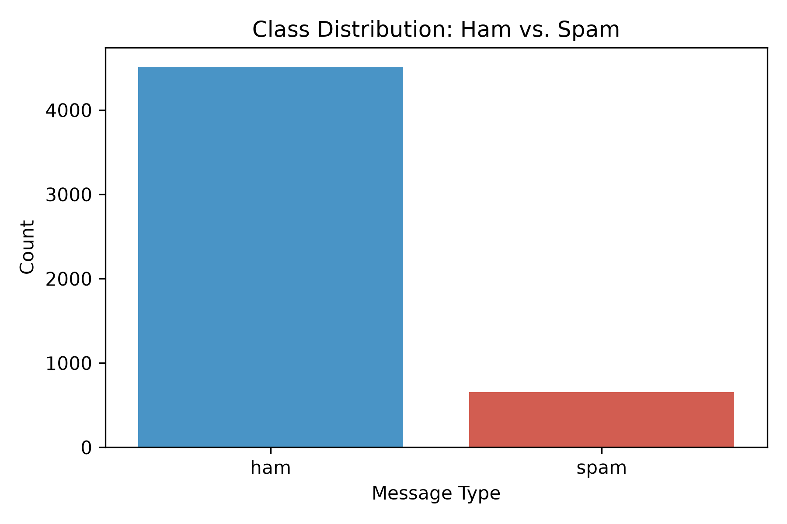
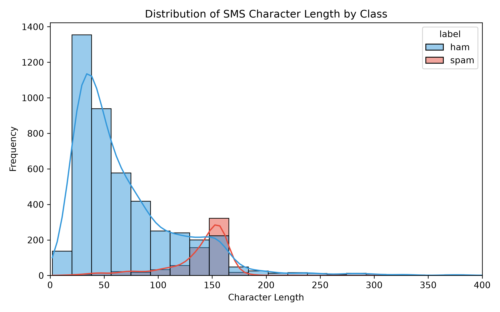
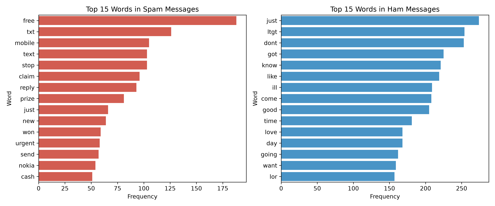
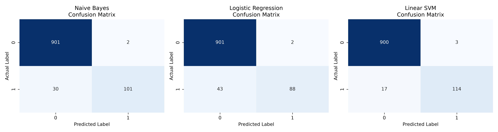

# 🛡️ SpamShield: AI-Based SMS Spam and Scam Message Detection System


**SpamShield** is an end-to-end machine learning application designed to classify Short Message Service (SMS) texts as either legitimate conversational messages (**Ham**) or unsolicited commercial/fraudulent threats (**Spam / Scam**). Developed as a Complex Computing Activity (CCA) for **CT-264: Programming for Artificial Intelligence** at **NED University of Engineering and Technology**, this project combines regex-driven text preprocessing, unigram/bigram TF-IDF feature extraction, comparative supervised model evaluation, and a real-time **Streamlit** web interface featuring a sigmoid-calibrated **Risk Score**.

---

## 👥 Project Team (BSCS - Cyber Security)

| Roll Number        | Student Name            | Key Responsibilities                                                               |
| :----------------- | :---------------------- | :--------------------------------------------------------------------------------- |
| **CT-24278** | **Muhammad Saad** | Exploratory Data Analysis (EDA), Statistical Summaries & Data Visualization        |
| **CT-24125** | **Haris Zamir**   | Model Training (Naive Bayes, Logistic Regression, Linear SVM) & Metric Evaluation  |
| **CT-24136** | **Ali Hassan**    | Streamlit Web Interface, Sigmoid Risk Score Calibration & Technical Report         |
| **CT-24138** | **Muhammad Raza** | Core Python Pipeline Architecture, Regex Text Preprocessing & TF-IDF Vectorization |

---

## ✨ Key Features

* **Automated Data Hygiene & Deduplication:** Cleanses the raw UCI SMS Spam Collection dataset ($5,572$ rows) by stripping malformed CSV overflow columns and removing $403$ duplicate campaigns, resulting in $5,169$ unique records.
* **Comprehensive Exploratory Data Analysis (EDA):** Generates publication-ready statistical distributions comparing character length, word count, class imbalance ($87.37\%$ Ham vs. $12.63\%$ Spam), and top lexical triggers.
* **N-Gram TF-IDF Vectorization:** Extracts the top $3,000$ unigram and bigram features ($\text{ngram\_range}=(1, 2)$) while filtering English stop words and preserving numeric shortcodes.
* **Multi-Model Benchmarking:** Trains and evaluates **Multinomial Naive Bayes**, **Logistic Regression**, and **Linear Support Vector Machine (`LinearSVC`)** on a stratified $80/20$ train-test split.
* **Interactive Streamlit Threat Analyzer:** Provides an intuitive web UI where users can paste any SMS message to receive an instant classification verdict alongside a continuous **Calculated Risk Score ($0\%$–$100\%$)**.

---

## 📂 Repository Structure

```text
SpamShield/
├── data/
│   ├── raw/
│   │   └── spam.csv                      # Original UCI SMS Spam Collection dataset
│   └── processed/
│       └── cleaned_spam.csv              # Deduplicated & regex-cleaned dataset (5,169 records)
├── models/
│   ├── tfidf_vectorizer.pkl              # Fitted 3,000-feature TF-IDF vectorizer
│   └── best_spam_model.pkl               # Serialized best model (LinearSVC)
├── outputs/
│   ├── figures/
│   │   ├── class_distribution.png        # Ham vs. Spam class distribution bar chart
│   │   ├── message_length_dist.png       # Character length histogram & KDE by class
│   │   ├── top_words_comparison.png      # Top 15 lexical tokens in Spam vs. Ham
│   │   └── confusion_matrices.png        # Side-by-side confusion matrix heatmaps
│   └── metrics_report.txt                # Exported classification performance summary
├── src/
│   ├── __init__.py
│   ├── preprocess.py                     # Phase 1: Cleaning, EDA & TF-IDF pipeline
│   └── train_evaluate.py                 # Phase 2: Model training, evaluation & serialization
├── docs/
│   └── Technical_Report.md               # Phase 4: Complete CCA technical report
├── app.py                                # Phase 3: Streamlit web interface & risk engine
├── requirements.txt                      # Python package dependencies
├── .gitignore                            # Git ignore rules
└── README.md                             # Project documentation
```

---

## 📊 Exploratory Data Analysis (EDA)

### 1. Structural Statistical Summary

Spam messages are nearly twice as long on average ($137.89$ characters) as legitimate messages ($70.46$ characters), clustering tightly near the standard $160$-character SMS billing limit.

| Class Label            | Metric           |   Count   |    Mean    |  Median  |  Min  |   Max   | Std. Dev. |
| :--------------------- | :--------------- | :-------: | :--------: | :-------: | :----: | :-----: | :-------: |
| **Ham (`0`)**  | Character Length | $4,516$ | $70.46$ | $52.0$ | $2$ | $910$ | $56.36$ |
| **Spam (`1`)** | Character Length |  $653$  | $137.89$ | $149.0$ | $13$ | $224$ | $30.14$ |
| **Ham (`0`)**  | Word Count       | $4,516$ | $14.13$ | $11.0$ | $1$ | $171$ | $11.12$ |
| **Spam (`1`)** | Word Count       |  $653$  | $23.68$ | $25.0$ | $2$ | $35$ | $5.97$ |

### 2. Visual Insights

|                      Class Distribution                      |                      Character Length Distribution                      |
| :-----------------------------------------------------------: | :---------------------------------------------------------------------: |
|  |  |

#### Top 15 Lexical Triggers (Spam vs. Ham)



---

## 🤖 Model Performance & Evaluation

All three models were evaluated on an unseen $20\%$ stratified test set ($1,034$ messages: $903$ Ham, $131$ Spam). **Linear SVM (`LinearSVC`)** achieved the highest overall **F1-Score ($91.13\%$)** and **Recall ($86.26\%$)**, making it the optimal model for deployment.

| Model                                     |       Accuracy       |       Precision       |        Recall        |       F1-Score       |        Status        |
| :---------------------------------------- | :-------------------: | :-------------------: | :-------------------: | :-------------------: | :-------------------: |
| **Naive Bayes (`MultinomialNB`)** |      $97.10\%$      | **$98.10\%$** |      $78.63\%$      |      $87.29\%$      |       Runner-up       |
| **Logistic Regression**             |      $95.65\%$      |      $97.78\%$      |      $67.18\%$      |      $79.64\%$      |       Baseline       |
| **Linear SVM (`LinearSVC`)**      | **$97.87\%$** |      $96.58\%$      | **$86.26\%$** | **$91.13\%$** | 🏆 **Deployed** |

### Confusion Matrices



---

## 🚀 Installation & Usage Guide

### 1. Clone the Repository

```bash
git clone https://github.com/RazaJavaid2004/Spam-Shield.git
cd SpamShield
```

### 2. Install Dependencies

```bash
pip install -r requirements.txt
```

### 3. Run the Pipeline (Optional – Models & Plots Included)

If you want to regenerate the cleaned dataset, EDA charts, and model `.pkl` artifacts from scratch:

```bash
# Phase 1: Data Preprocessing & EDA
python src/preprocess.py

# Phase 2: Model Training & Evaluation
python src/train_evaluate.py
```

### 4. Launch the Streamlit Web App

```bash
python -m streamlit run app.py
```

The application will open automatically in your default browser at `http://localhost:8501`.

---

## 🧪 Sample Test Cases for Verification

Try pasting these test messages into the Streamlit interface to observe how **SpamShield** computes threat verdicts and sigmoid-calibrated risk scores:

| Scenario                          | Sample SMS Input                                                                                                                |                 Verdict                 |      Risk Score      |
| :-------------------------------- | :------------------------------------------------------------------------------------------------------------------------------ | :--------------------------------------: | :-------------------: |
| **Lottery / Prize Scam**    | `come there as soon as possibleURGENT! You have won a FREE £1000 cash prize and a new Nokia mobile! Txt CLAIM to 87121 now!` |         🚨 **SPAM / SCAM**         | **$91.26\%$** |
| **Subscription Spam**       | `FREE entry into our £250 weekly comp! Text WIN to 80086 now to claim your guaranteed gift voucher. T&Cs apply.`             |         🚨 **SPAM / SCAM**         | **$84.36\%$** |
| **University / Academic**   | `Hey bro, are we still meeting at the CSIT lab at 11 AM tomorrow to finalize the PAI project report?`                         |      ✅ **LEGITIMATE (HAM)**      | **$23.21\%$** |
| **Everyday Conversational** | `I'm running about 10 minutes late, traffic near the main gate is packed. Don't wait up for me.`                              |      ✅ **LEGITIMATE (HAM)**      | **$28.75\%$** |
| **Borderline Trigger**      | `Call me back when you are free, I have some urgent news to tell you about the cash we collected.`                            | 🚨 **SPAM / SCAM** *(Edge Case)* | **$61.00\%$** |

---

## 📜 Dataset Citation & Acknowledgments

* **Dataset:** Almeida, T.A., Gómez Hidalgo, J.M., Yamakami, A. *Contributions to the Study of SMS Spam Filtering: New Collection and Results*. Proceedings of the 2011 ACM Symposium on Document Engineering (DocEng'11), Mountain View, CA, USA, 2011. ([Kaggle Link](https://www.kaggle.com/datasets/uciml/sms-spam-collection-dataset))
